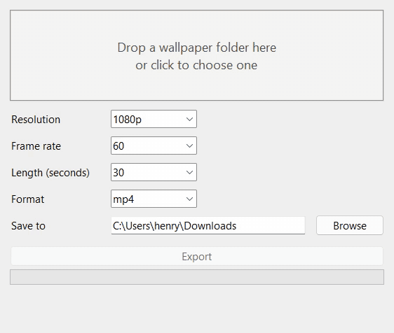
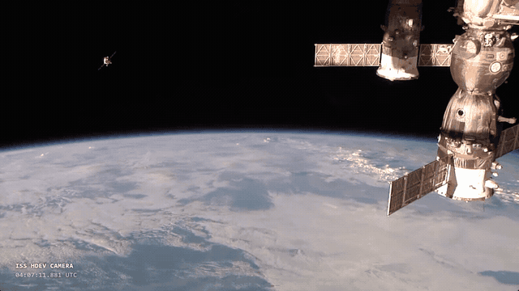

# wp2video

<em>Turn a Wallpaper Engine wallpaper into an MP4 or WebM file, or a full-size still, on Windows.</em>

<p align="center">
  
  <br>
  <sub>A real export of the example wallpaper in <code>examples/iss-earth</code>, recorded from the app (31 s, played at 1.5x). A script clicked through the GUI; the export itself is unmodified.</sub>
</p>

<p align="center">
  
  <br>
  <sub>The file that export produced, 5 s of it as a 640 px GIF (the MP4 is 1920x1080 at 60 fps). The clock is drawn live by the wallpaper's page, so it shows Wallpaper Engine rendering it, not a copied video.</sub>
</p>

wp2video opens the wallpaper in Wallpaper Engine's own renderer, in a window placed off-screen, and records that window with ffmpeg. Scene and web wallpapers keep their animation, effects and particles, because Wallpaper Engine is what draws them.

## Demo

https://github.com/user-attachments/assets/1dfc0594-6821-4d3f-a305-ec61bdf8f49f

A 33 s cut of real recordings: the GUI export above (sped up 3.4x from Export to Done), the file it saved, and the terminal run. Edited in Remotion; no screen in it is mocked.

## Get it

You need **Windows 10 or 11** and **Wallpaper Engine** (from Steam).

1. Go to the [latest release](https://github.com/unio207/wp2video/releases/latest) and click **wp2video.zip** to download it. It's 100 MB, or 240 MB unzipped, almost all of it `ffmpeg.exe`.
2. Right-click the downloaded zip, choose **Extract All...**, then click **Extract**.
3. Open the extracted `wp2video` folder and double-click **wp2video.exe**.
   If Windows says *"Windows protected your PC"*, click **More info**, then **Run anyway**. This appears because the exe isn't code-signed.

Keep `wp2video.exe` and `ffmpeg.exe` in the same folder.

## Make a video

1. Drag a wallpaper folder onto the window, or click the box to choose one.
   Wallpaper folders are in `Steam\steamapps\workshop\content\431960\<id>\`.
   In Wallpaper Engine, right-click a wallpaper and choose **Open in Explorer** to find one.
   To try it without picking one, use `examples\iss-earth` from this repo.
2. Pick resolution (1080p, 1440p, 4K), frame rate (30, 60, or Max: as high as the wallpaper renders, up to 240 and up to Wallpaper Engine's own FPS limit in its Performance settings), length in seconds and format (mp4, webm, or png for a still).
   If the wallpaper says how long it loops, Length is filled in for you (see [Loops](#loops)). Tick **Seamless loop** to make any length loop, and, for web wallpapers, **render in the browser** to skip Wallpaper Engine (see [Web wallpapers in the browser](#web-wallpapers-in-the-browser)).
3. Click **Export**. When it's done, click the file name to show it in Explorer.

Videos are saved to your **Downloads** folder unless you pick another one.

Limits: the file has no audio. Video wallpapers skip the recording: the source file is copied, or converted if the format differs, so they ignore the resolution, frame rate and length settings, and WebM conversion of them is always VP9 on the CPU. Application wallpapers aren't supported.

Without the GUI, the same export runs from a terminal:

```console
> python wp2video.py examples\iss-earth 1080p 60 10 mp4 out
Starting Wallpaper Engine...
Loading wallpaper...
Testing your PC's frame rate...
Recording 1920x1080 at 60 fps...
Saving...
saved: out\ISS Earth view (1920x1080 60fps).mp4
```

The arguments are `<folder> [1080p|1440p|4K] [30|60|Max] [seconds|loop] [mp4|webm|png] [out dir] [--seamless] [--browser]`; `loop` uses the length the wallpaper says it loops for.

On an RTX 4060 with NVENC, a 6 s export takes 10.4 s end to end, where it took 17.2 s before the load wait below was cut. About 4 s of it is not recording: up to 0.5 s waiting for the wallpaper to draw (`wait_until_drawn`) and 3.4 s measuring its frame rate (`measure_fps`). If Wallpaper Engine isn't already running, starting it adds a fixed 8 s.

## The example wallpaper

`examples/iss-earth` is a small web wallpaper made for this repo: `project.json`, an `index.html` that loops `earth.webm` (14 s, 1280x720, 1 MB) and draws a clock on top. The footage is from NASA's [Earth Views from the International Space Station](https://images.nasa.gov/details/Earth%20Views%20from%20the%20International%20Space%20Station) (HDEV camera), trimmed to 1:48-2:02 and re-encoded. NASA material is public domain in the US; the NASA name and insignia aren't used here.

Wallpaper Engine opens it straight from the repo folder, so it doesn't have to be in the Workshop folder.

## How it works

All of it is in `wp2video.py`.

- **Rendering.** It runs `wallpaper64.exe -control openWallpaper -playInWindow`, then moves that window just left of the leftmost monitor, so your desktop and current wallpaper stay as they are. If a system doesn't render off-screen windows (the capture measures under 2 fps), it moves the window on-screen and tries again. In that case the window covers the top-left of your main screen while it records.
- **Capture.** ffmpeg's `gfxcapture` filter (Windows Graphics Capture, ffmpeg 8.0+) records the window by handle, without the cursor. The PC is kept awake while it records.
- **Frame rate.** It captures for 3 s first, capped at your pick, and counts the frames. Reaching 90% of the pick counts as keeping up, because the capture limiter delivers less than its cap even when the wallpaper keeps pace: capped at 60, both test wallpapers read 55 to 57 fps, and capped at 30, 28. Below 90%, the output uses the highest standard rate (24, 30, 48, 60, 90 ... 240) at or below 1.05 × the measured rate. A constant rate the PC can't keep up would fill the file with duplicated frames, so it rounds down instead. The floor is 24 fps, so a PC rendering below about 23 fps still gets duplicated frames. With Max, a 4K Workshop scene measured about 80 fps here and was saved at 60, and the example measured 175 and was saved at 180. Wallpaper Engine's limit on this PC is 180.
- **Aspect ratio.** A scene whose native size differs from the output (read from `scene.json`, loose or inside `scene.pkg`) is rendered whole at its own aspect ratio, then cropped. The crop follows the alignment slider you set for that wallpaper in Wallpaper Engine (read from its `config.json`), so the video frames the wallpaper the way your desktop does.
- **Encoding.** It probes NVENC, AMF and Quick Sync in that order and uses the first that works, falling back to x264 or x265 on the CPU. When the pixel rate goes past 4K at 60 fps (4K above 60, or 1440p at 144 and up, both only reachable with Max) it switches to HEVC, because that is past what H.264 encoders handle (the `heavy` check in `export()`). WebM is AV1 when the GPU can encode it; otherwise it's re-encoded to VP9 afterwards, which is slower.
- **Loading.** It waits until the window shows anything other than black, checking a 32x18 capture of it, instead of a fixed 7 s. Wallpapers drew within 0.5 s in testing; a page still starting up (the example's video started at 2.6 s) settles during the 3 s frame-rate test. A wallpaper that stays black still gets the full 7 s.
- **Drag and drop** uses the Win32 `WM_DROPFILES` message directly, so the GUI is plain tkinter with no extra packages.

## Stills

Format **png** saves one full-size frame instead of a video. Frame rate, length and Seamless loop don't apply.

- **Scenes** render at their own resolution, uncropped, whatever Resolution says. That's 3840x2160 for Peace of Mind and 4700x2001 for Gantry and Sunshine here. The still is taken 2 s after the scene first draws, past intro fades.
- **Web wallpapers** use the chosen resolution, since a page has no size of its own. With render in the browser, the PNG is a lossless screenshot 2 s into the page's virtual clock.
- **Video wallpapers** give a frame from 1 s in, at the video's own size.

## Loops

When you drop a wallpaper, wp2video fills in Length if the wallpaper declares how long it loops (`loop_length()` in `wp2video.py`):

- **Video wallpapers** loop with their file.
- **Web wallpapers** built around one looping `<video>` loop with that video. For `examples/iss-earth` that's 14.03 s. Its clip was cut from longer footage, so the video's own restart is a visible jump.
- **Scenes** loop only if they have timeline animations set to loop. The loop is the least common multiple of their lengths. Of the 18 scenes installed here, one declares one: Minecraft Earth by WLabs, 29 frames at 2.9 fps, so 10 s. Particles and time-driven shader effects have no declared period, so even that scene doesn't repeat exactly.

**Seamless loop** works for anything. It records an extra second (or a quarter of a short clip), starts the file that far in, and crossfades the last second into the recording's first, so the last frame leads into the first (`make_seamless()`). On a 6 s export of a Workshop scene, the step from last frame to first measured 46.9 dB PSNR, against 43 dB between ordinary neighbouring frames.

## Web wallpapers in the browser

With **render in the browser** (`--browser`), a web wallpaper is rendered by headless Microsoft Edge (Chrome if Edge isn't installed) instead of Wallpaper Engine (`webrender.py`). A script injected before the page loads replaces its clock: `performance.now`, `Date`, timers and `requestAnimationFrame`. Each frame is then rendered at its exact time. Videos and CSS animations are seeked to that time and the page is screenshotted, so a 10 s, 60 fps file has exactly 600 distinct frames whatever the PC's speed. Wallpaper Engine doesn't need to be installed.

- **Speed.** It is not faster than recording. Screenshots cost 47 ms a frame at 1080p and 112 ms at 4K, so a 10 s 1080p60 clip takes about 31 s in two browsers at once. One browser took 47 s, and four took 35 s. The clip is split between the browsers and joined without re-encoding. Each browser first runs the page clock from zero to its first frame, and `Math.random` is seeded, so pages that build up state match across the join.
- **Limits.** Pages hear silence from Wallpaper Engine's audio API and get their `project.json` default settings. CSS animations that start later are timed from zero. Frame rate Max means 60, since there's no PC speed to measure.
- **No extra packages.** It speaks the browser's DevTools protocol over a small built-in WebSocket client.

## Build from source

Needs Python 3.8 or newer (built here with 3.12) and ffmpeg 8.0 or newer. Run these in the repo folder:

```console
winget install Gyan.FFmpeg
python -m venv .venv
.venv\Scripts\pip install pyinstaller
build.bat
```

This makes `release\wp2video.zip`, with `wp2video.exe`, `ffmpeg.exe` and `LICENSES.txt` at its top level. `build.bat` uses the most recently installed ffmpeg from winget and writes its version into `LICENSES.txt`. To use a different ffmpeg, pass its folder (the one that contains `bin\`): `build.bat C:\path\to\ffmpeg-build`. It runs PyInstaller as `python -m PyInstaller` rather than `pyinstaller.exe`, because pip's exe launchers hard-code the venv's path and stop working if the folder is moved.

To run without building, use `python wp2video.py` with `ffmpeg.exe` next to it or on PATH. There are no automated tests. The checks are manual exports like the one above.

## License

wp2video is MIT licensed (see `LICENSE`). The bundled `ffmpeg.exe` is an unmodified FFmpeg build under GPLv3. It runs as a separate program and is not covered by the MIT license; `LICENSES.txt` in the zip has the full text and source links. The example footage is NASA's and public domain (see [The example wallpaper](#the-example-wallpaper)).
